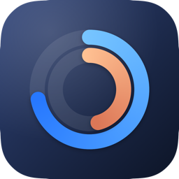
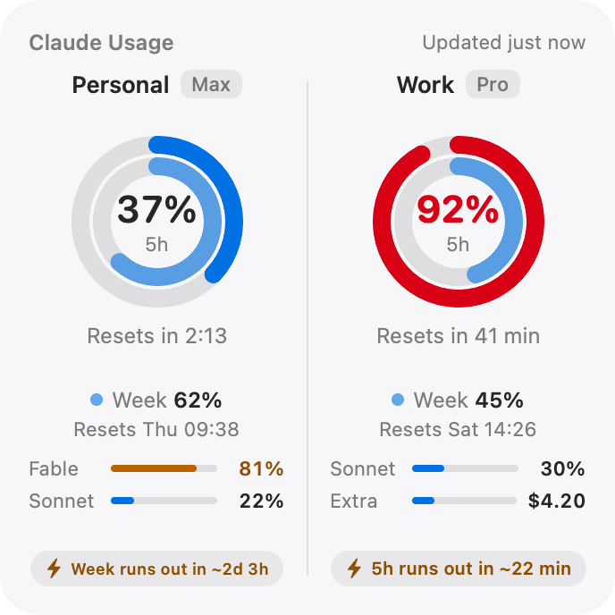
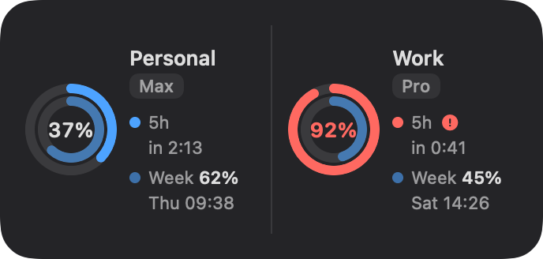
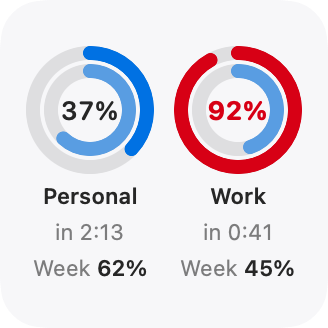

<p align="center">
  
</p>

<h1 align="center">Claude Quota</h1>

<p align="center">A macOS desktop widget that shows the usage limits of two Claude accounts side by side.</p>

<p align="center">
  
</p>
<p align="center">
  
  
</p>

## Features

- **Two accounts at once** (up to four). Each account logs in to claude.ai in its own isolated web data store, so the logins never mix.
- **Dual rings.** The outer ring is the 5-hour session window and the inner ring is the weekly limit. Comes in small, medium and large sizes.
- **Pace hint** (large size). Projects the average rate so far in each window and warns when you would run out before it resets.
- **Per-model limits and extra usage** (large size), when your plan has them.
- **Readable at a glance.** Blue below 70%, orange from 70%, red and bold from 90%. The 90% state also gets an icon, so it stays visible in the monochrome desktop style macOS uses when another app is in front.
- **Chinese or English.** Pick the language in Settings, or follow the system language. The widget follows the app.

## Requirements

- macOS 14 Sonoma or later
- Xcode 15 or later, and Homebrew (to build)

## Build and install

```sh
./build.sh
```

The script installs [XcodeGen](https://github.com/yonaskolb/XcodeGen) if needed, generates the Xcode project from `project.yml`, builds a Release build with a fresh build number, installs it to `/Applications/ClaudeQuota.app`, and restarts the widget so the desktop picks up the new version.

## Use

1. Open **Claude Quota**. Its settings window opens the first time; later, use the gauge icon in the menu bar → **Settings…**.
2. Name each account, then click **Log In…** and sign in to claude.ai in the window that opens. It closes by itself once you are logged in.
3. Right-click the desktop → **Edit Widgets**, search for **Claude**, and drag the size you want onto the desktop.
4. Turn on **Open at login** so the numbers keep updating after a restart.

### Logging in with email

claude.ai emails a sign-in link, and your mail app opens it in the default browser rather than in the login window. Either:

- right-click the link in the email, choose **Copy Link**, paste it into the bar at the top of the login window and click **Open Link**; or
- open the link in the browser, which then shows a verification code, and type that code into the login window.

### sessionKey fallback

If the built-in login page doesn't work for an account, open the **…** menu next to it and choose **Paste sessionKey…**, using the `sessionKey` cookie copied from a browser where you are logged in to claude.ai (Developer Tools → Application → Cookies).

## How it works

- A menu bar app keeps one WebKit data store per account and asks claude.ai for `/api/organizations/{org}/usage` from inside a hidden web view, the same request the claude.ai settings page makes. It refreshes every 2–15 minutes and after the Mac wakes.
- The app writes the latest numbers to `~/Library/Application Support/ClaudeQuota/snapshot.json`. The sandboxed widget reads only that file, through a read-only sandbox exception, so no App Group or paid developer account is needed. Builds are signed ad hoc.
- The widget keeps a one-entry-per-minute timeline so countdowns stay current between refreshes, and the app only asks WidgetKit to reload when something visible changes.

## Project layout

| Path | Contents |
| --- | --- |
| `App/` | Menu bar app: accounts, login window, settings, refresh loop |
| `Widget/` | WidgetKit extension: small, medium and large layouts |
| `Shared/` | Snapshot model, usage parser, formatting and the two languages |
| `Resources/` | Asset catalog with the app icon |
| `Tools/` | `render-assets.sh` regenerates the icon and the images in `docs/` |
| `project.yml` | XcodeGen spec (the `.xcodeproj` is generated and not committed) |

## Caveats

- The numbers come from claude.ai's internal web API, which is not a public API and may change without notice.
- Logins are stored only on this Mac. The app talks to nothing except claude.ai.
- This is an independent project, not affiliated with or endorsed by Anthropic.
